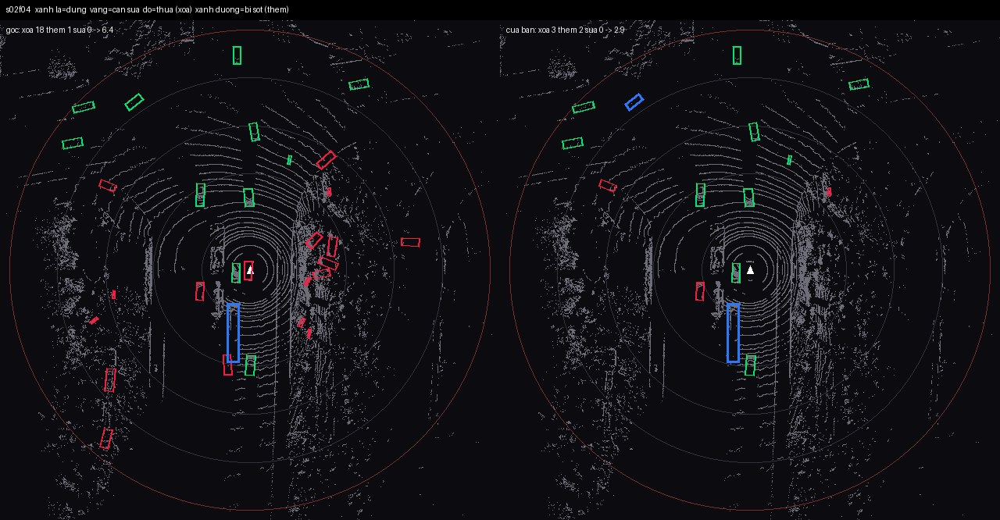

# Báo cáo Day 14 — Hoàng Trọng Trà — 2A202603342

- Mã học viên dùng với `--student`: `2A202603342`
- `seed_tag` trong `frames_A.txt`: `82ac3100fd`

## 1. Dự đoán trước sweep (bước 5b)

- Mình dự đoán tăng `score_thr` từ `0.1` lên khoảng `0.5` sẽ giảm chi phí sửa nhiều nhất trong lưới thử. Mình dự đoán giữ `min_points=0` vì ít thấy hộp có rất ít điểm trong kết quả ban đầu.
- Trên ảnh BEV và camera tập A, mình thấy nhiều hộp bám vào cây, hàng rào và vật cố định. Cấu hình gốc có 72 hộp cần xóa, 1 vật cần thêm và 2 hộp cần sửa, với chi phí 23,6. Trung vị score là 0,362 ở nhóm hộp không ghép được và 0,800 ở nhóm ghép được. Tăng ngưỡng có thể lọc nhiều hộp dư. Một số vật thật có score thấp cũng có thể bị lọc, nên mình sẽ kiểm tra cả cột thêm khi so sánh.

## 2. Tập A: sửa tay và tune

| Cấu hình | Xóa | Thêm | Sửa | Chi phí |
|---|---:|---:|---:|---:|
| Gốc | 72 | 1 | 2 | 23,6 |
| `best_config.json` | 11 | 9 | 1 | 12,8 |

- Tham số đã đổi trong `best_config.json`: `score_thr` tăng từ `0.1` lên `0.5`. `min_points` giữ ở `0`.
- Kết quả leave-one-out từ `scripts/pp_sweep.py`

  ```text
  s01f34: cấu hình chọn {'score_thr': '0.5', 'min_points': '0'} → 6.4 (tốt nhất có thể 6.4)
  s02f04: cấu hình chọn {'score_thr': '0.5', 'min_points': '0'} → 2.9 (tốt nhất có thể 2.9)
  s05f36: cấu hình chọn {'score_thr': '0.5', 'min_points': '0'} → 3.5 (tốt nhất có thể 3.5)
  ```

- Cấu hình có ổn định trên từng frame không? Có. Cả ba lượt đều chọn `score_thr=0.5` và `min_points=0`. Chi phí trên từng frame giữ lại bằng mức thấp nhất trong lưới. Ở ngưỡng `0.5`, cả ba mức `min_points` cho cùng tổng chi phí 12,8 điểm, nên mình giữ mức mặc định `0`.

## 3. Trước/sau (bước 8)



- `scripts/pp_compare.py` báo giảm 46% công sửa trên tập A. Tính từ 23,6 xuống 12,8 điểm thì mức giảm là 45,8%.
- Dự đoán ở mục 1 đúng trong lưới đã thử. Số hộp cần xóa giảm từ 72 xuống 11 và số hộp cần sửa giảm từ 2 xuống 1. Số hộp cần thêm tăng từ 1 lên 9 vì ngưỡng cao loại cả một số dự đoán từng ghép được. Tổng chi phí vẫn giảm.

## 4. Tập B

Số đo từ `scripts/pp_prelabel.py --data Data-VF/Data-VF --frames d14_2A202603342/frames_B.txt --config d14_2A202603342/best_config.json --gt d14_2A202603342/ref_B.json`:

| Xóa | Thêm | Sửa | Chi phí |
|---:|---:|---:|---:|
| 42 | 7 | 2 | 20,6 |

- Loại box tốn công sửa nhất ở tập B: `Car`, với 27 hộp dư tương đương 8,1 điểm.

## 5. Giới hạn

- Mình chỉ dùng ba frame tập A để chọn tham số. PointPillars học ba lớp trên KITTI và gán nhãn `Truck`, `Bus` bằng luật kích thước. Chi phí là điểm theo trọng số của lab. Muốn biết thời gian sửa thực tế cần đo thời gian thao tác.
